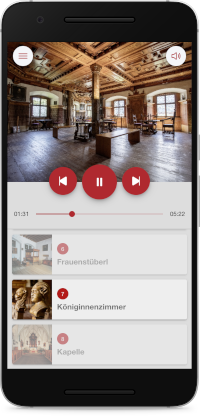
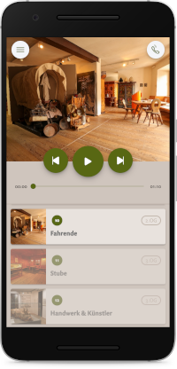
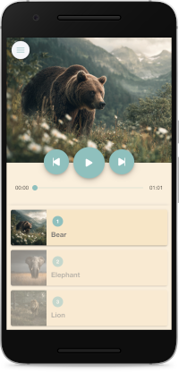
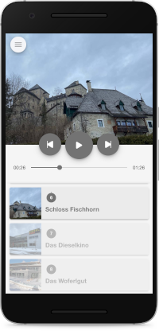

<div align="center">
  
</div>

<div align="center">

[](https://github.com/smartcompanion-app/audioguide-app/actions/workflows/ci.yml)
[](LICENSE)
[](CONTRIBUTING.md)

</div>

---

The SmartCompanion Audioguide App is a free and open-source Progressive Web App (PWA) that delivers interactive audioguide experiences for museums and cultural institutions. It runs seamlessly in any modern mobile browser — no installation required.

The app is fully customizable, allowing you to adapt content, colors, text, and images to fit your institution's needs. It also includes offline functionality powered by a service worker, ensuring smooth use even without an internet connection.

## Documentation

The full documentation lives at **[docs.smartcompanion.app](https://docs.smartcompanion.app/)**:

- [Quickstart](https://docs.smartcompanion.app/quickstart) — from fork to deployed app
- [Content](https://docs.smartcompanion.app/content) — the data format, stations, tours, languages and media
- [Customization](https://docs.smartcompanion.app/customization) — engraft variables, colors, fonts, logos and icons
- [Features](https://docs.smartcompanion.app/features) — audio, offline support, embedding and PWA installation
- [Deployment](https://docs.smartcompanion.app/deployment) — GitHub Pages, Netlify, self-hosting or the managed plan
- [Reference](https://docs.smartcompanion.app/reference) — configuration, scripts, browser support, versioning and troubleshooting

## Features

- 🎧 **Interactive Audioguide** — station-based audio playback for museum tours
- 📱 **Progressive Web App** — works in any modern browser, no app store needed
- 🌐 **Multilingual** — built-in i18n support for multiple languages
- 📶 **Offline Support** — optional service worker caching for use without internet
- 🎨 **Fully Customizable** — adapt colors, content, images, and branding
- 🌗 **Light & Dark Mode** — automatically follows the user's system preference
- ⚡ **Lightweight** — built with Stencil.js and Ionic for fast performance
- 🆓 **Open Source** — BSD 2-Clause license

## Examples

| [Castle Tratzberg](https://www.smartcompanion.app/projects/mobile-apps/schloss-tratzberg/) | [Museum Landeck](https://www.smartcompanion.app/projects/mobile-apps/schloss-landeck/) | [Example App (Animals)](https://smartcompanion-app.github.io/audioguide-app/animals) | [Example App (Leon)](https://smartcompanion-app.github.io/audioguide-app/leon) |
|---|---|---|---|
|  |  |  |  |

## Getting Started

Fork and clone the repo, then:

```bash
npm install        # Install dependencies
npm start          # Dev server with hot reload at http://localhost:3333
npm run build      # Production build → www/
```

Turning the sample app into your own is covered in the [Quickstart](https://docs.smartcompanion.app/quickstart).

## Contributing

Contributions are welcome. See [CONTRIBUTING.md](CONTRIBUTING.md) for the local setup, the two test modes, and how releases work. Everyone taking part is expected to follow the [Code of Conduct](CODE_OF_CONDUCT.md). Security issues go through [SECURITY.md](SECURITY.md), not the issue tracker.

## License

The SmartCompanion Audioguide App is licensed under the terms of the BSD 2-Clause license. Check the [LICENSE](LICENSE) file for further details.

## Links

- [Documentation](https://docs.smartcompanion.app/)
- [Website](https://www.smartcompanion.app)
- [SmartCompanion Library](https://github.com/smartcompanion-app/smartcompanion-library)
- [Native Audio Capacitor Plugin](https://github.com/smartcompanion-app/native-audio-player)
- [engraft](https://github.com/smartcompanion-app/engraft)
